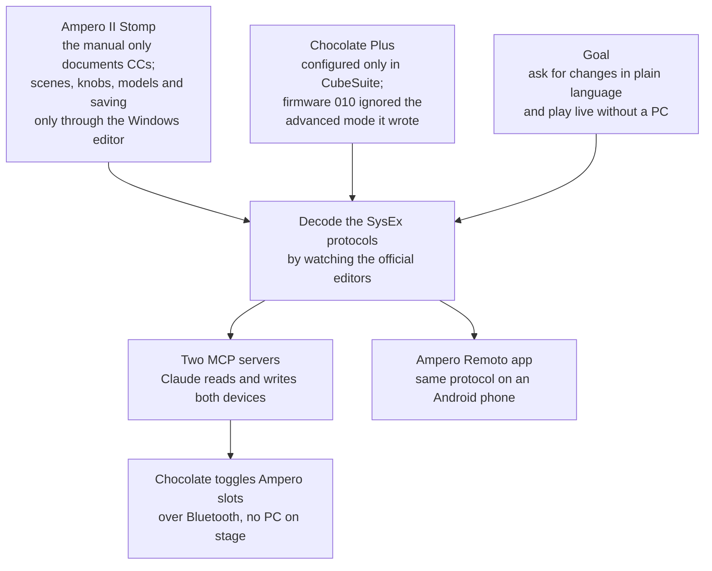
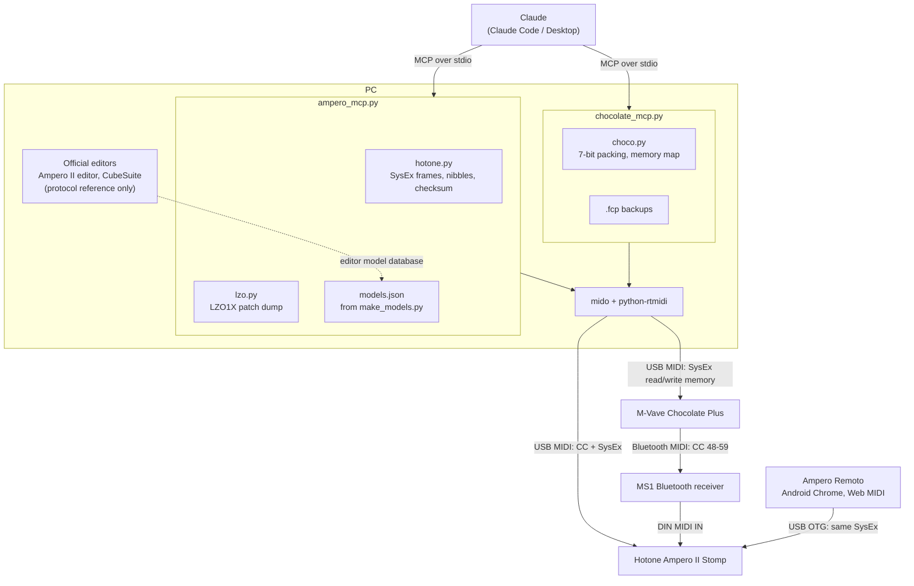

# AmperoStompII-MCP

Two MCP servers that let Claude control a **Hotone Ampero II Stomp** guitar processor and an
**M-Vave Chocolate Plus** foot controller, both connected to the PC over USB MIDI.

*Leia em português: [README.pt-BR.md](README.pt-BR.md)*

**Companion phone app:** [Ampero Remoto](https://github.com/JuliaNazka/ampero-remoto), the same protocol in JavaScript (Web MIDI PWA) to control the pedal from an Android phone. [Open it live](https://julianazka.github.io/ampero-remoto/).

<!-- DEMO: put a short GIF here (Claude switching a patch or turning a slot on, and the pedal reacting).
 -->

Personal project, not affiliated with Hotone or M-Vave. The SysEx protocol of both devices was decoded by
watching the traffic of the official editors; use at your own risk.

## Why this exists



## Architecture



## Example prompts

- *"Switch to patch A01-2 and turn on slot B3."*
- *"Read the current patch and tell me which amp model is in the chain."*
- *"Open the tuner."*
- *"Set pedal 1 on the Chocolate to toggle slot A1 on the Ampero."*

## ampero: Hotone Ampero II Stomp

Tested with firmware 2.4.0 and editor 1.4.0.

- **CC (table from manual 1.3.0):** `select_patch`, `step_patch`, `step_bank`, `set_slot` (turns A1–B6 on and off),
  `tuner`, `set_tempo`, `tap_tempo`, `set_patch_volume`, `expression`, `quick_access`, `looper`, `device_mode`,
  `send_raw`.
- **SysEx:** `read_patch` (chain, models, knobs and on/off per scene), `list_patches`, `select_scene`,
  `set_param`, `set_model`, `save_patch`, `list_models`.
- `listen` shows what the pedal sends.

Knob, model and scene changes apply immediately, but they are only stored in the patch with `save_patch`.

On the Stomp: GLOBAL > MIDI > MIDI IN SOURCE set to "USB Only" or "Mixed". The USB input channel must match
the `AMPERO_CHANNEL` variable (default 5).

**models.json** (model and parameter names) is not in the repository, because the data belongs to Hotone. With the
official editor installed, generate it with:

```
python ampero/make_models.py
```

Protocol details at the top of `ampero/hotone.py`. The patch dump is LZO1X-compressed (`ampero/lzo.py`).

## chocolate: M-Vave Chocolate Plus

Reads and writes the pedal configuration over USB, the same way CubeSuite does. The Chocolate switch must be set to **U**.

- `read_buttons` / `set_button`: Advanced custom mode (press mode and up to 16 messages per bank).
  Works on firmware 012; firmware 010 does not read this format.
- `read_stomp` / `set_stomp`: Custom mode, one CC per pedal, toggling 127/0 on each press.
- `listen`, `backup`, `restore`: listens to presses and saves or restores the whole memory (.fcp file, same as
  CubeSuite's Export).

Backups go to `chocolate/backups/` (outside the repository). Protocol and memory map at the top of
`chocolate/choco.py`.

## Install

Python 3.11 or newer:

```
pip install mido python-rtmidi "mcp>=2"
```

Example registration in Claude Code (`~/.claude.json`, under `mcpServers`):

```json
"ampero": {
  "type": "stdio",
  "command": "python",
  "args": ["C:\\path\\to\\ampero\\ampero_mcp.py"],
  "env": { "AMPERO_CHANNEL": "5" }
},
"chocolate": {
  "type": "stdio",
  "command": "python",
  "args": ["C:\\path\\to\\chocolate\\chocolate_mcp.py"]
}
```

With the Microsoft Store Python, add `-E` before the script path.

## License

GPL-3.0, see [LICENSE](LICENSE). The LZO1X decompressor follows the miniLZO reference code, which is GPL.
