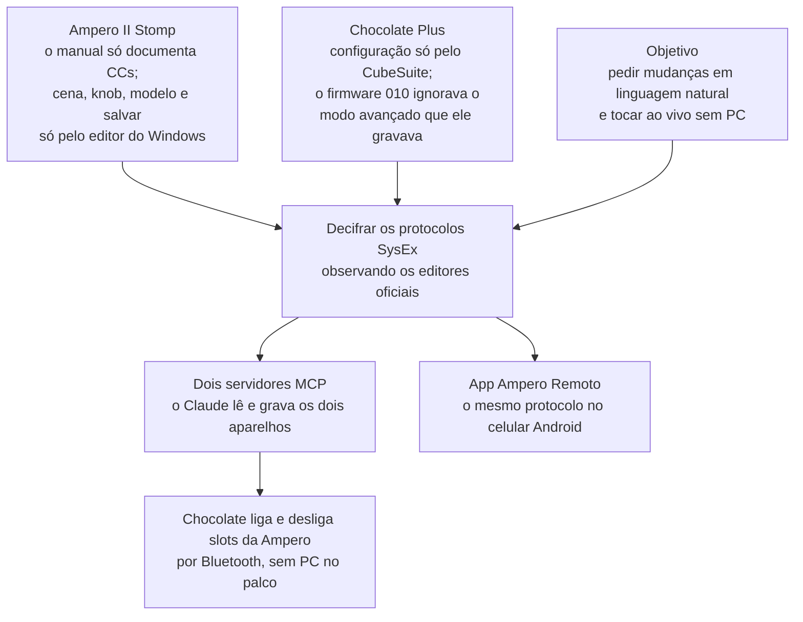
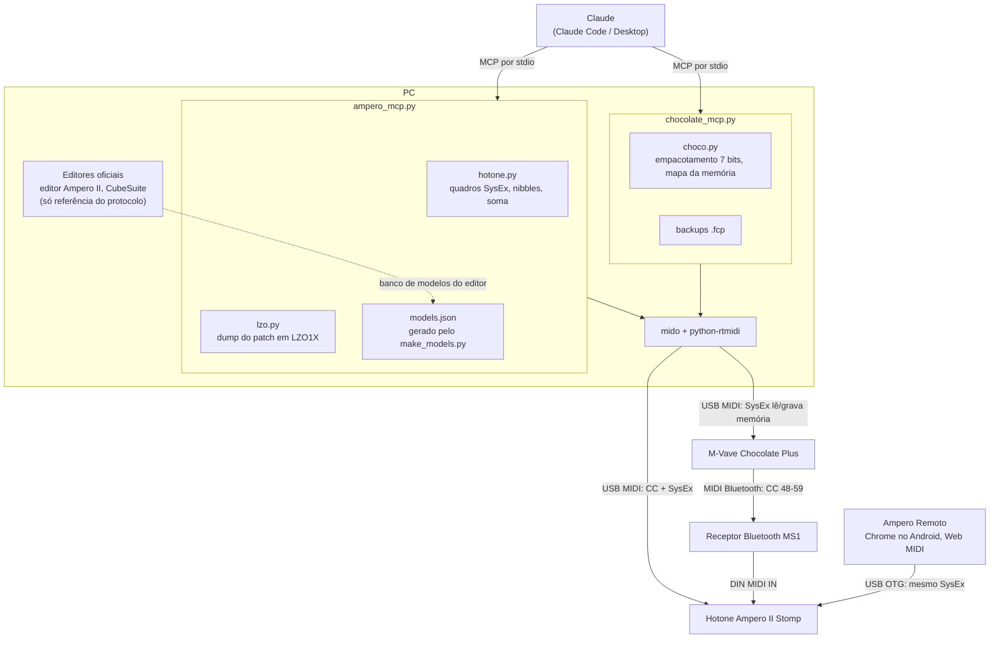

# AmperoStompII-MCP

Dois servidores MCP para controlar, pelo Claude, uma pedaleira **Hotone Ampero II Stomp** e um controlador
**M-Vave Chocolate Plus**, ambos ligados no PC por USB MIDI.

*Read in English: [README.md](README.md)*

**App para celular:** [Ampero Remoto](https://github.com/JuliaNazka/ampero-remoto), o mesmo protocolo em JavaScript (PWA com Web MIDI) para controlar a pedaleira pelo Android. [Abrir o app](https://julianazka.github.io/ampero-remoto/).

Projeto pessoal, sem relação com a Hotone nem com a M-Vave. O protocolo SysEx dos dois aparelhos foi decifrado
observando o tráfego dos editores oficiais; use por sua conta.

## Por que este projeto existe



## Arquitetura



## ampero: Hotone Ampero II Stomp

Testado com firmware 2.4.0 e editor 1.4.0.

- **CC (tabela do manual 1.3.0):** `select_patch`, `step_patch`, `step_bank`, `set_slot` (liga e desliga A1–B6),
  `tuner`, `set_tempo`, `tap_tempo`, `set_patch_volume`, `expression`, `quick_access`, `looper`, `device_mode`,
  `send_raw`.
- **SysEx:** `read_patch` (cadeia, modelos, knobs e liga/desliga por cena), `list_patches`, `select_scene`,
  `set_param`, `set_model`, `save_patch`, `list_models`.
- `listen` mostra o que a pedaleira manda.

Mudanças de knob, modelo e cena valem na hora, mas só ficam no patch com `save_patch`.

Na Stomp: GLOBAL > MIDI > MIDI IN SOURCE em "USB Only" ou "Mixed". O canal de entrada USB tem que bater com
a variável `AMPERO_CHANNEL` (padrão 5).

**models.json** (nomes dos modelos e parâmetros) não está no repositório, porque os dados são da Hotone. Com o
editor oficial instalado, gere com:

```
python ampero/make_models.py
```

Detalhes do protocolo no topo de `ampero/hotone.py`. O dump de patch vem comprimido em LZO1X (`ampero/lzo.py`).

## chocolate: M-Vave Chocolate Plus

Lê e grava a configuração dos pedais pela USB, como o CubeSuite faz. A chave do Chocolate tem que estar em **U**.

- `read_buttons` / `set_button`: modo Advanced custom (modo de pisada e até 16 mensagens por banco).
  Funciona no firmware 012; o 010 não lê esse formato.
- `read_stomp` / `set_stomp`: modo Custom, um CC por pedal, alternando 127/0 a cada pisada.
- `listen`, `backup`, `restore`: escuta as pisadas e salva ou volta a memória inteira (arquivo .fcp, igual ao
  Export do CubeSuite).

Os backups ficam em `chocolate/backups/` (fora do repositório). Protocolo e mapa da memória no topo de
`chocolate/choco.py`.

## Instalação

Python 3.11 ou mais novo:

```
pip install mido python-rtmidi "mcp>=2"
```

Exemplo de registro no Claude Code (`~/.claude.json`, em `mcpServers`):

```json
"ampero": {
  "type": "stdio",
  "command": "python",
  "args": ["C:\\caminho\\para\\ampero\\ampero_mcp.py"],
  "env": { "AMPERO_CHANNEL": "5" }
},
"chocolate": {
  "type": "stdio",
  "command": "python",
  "args": ["C:\\caminho\\para\\chocolate\\chocolate_mcp.py"]
}
```

Com o Python da Microsoft Store, rode com `-E` antes do caminho do script.
